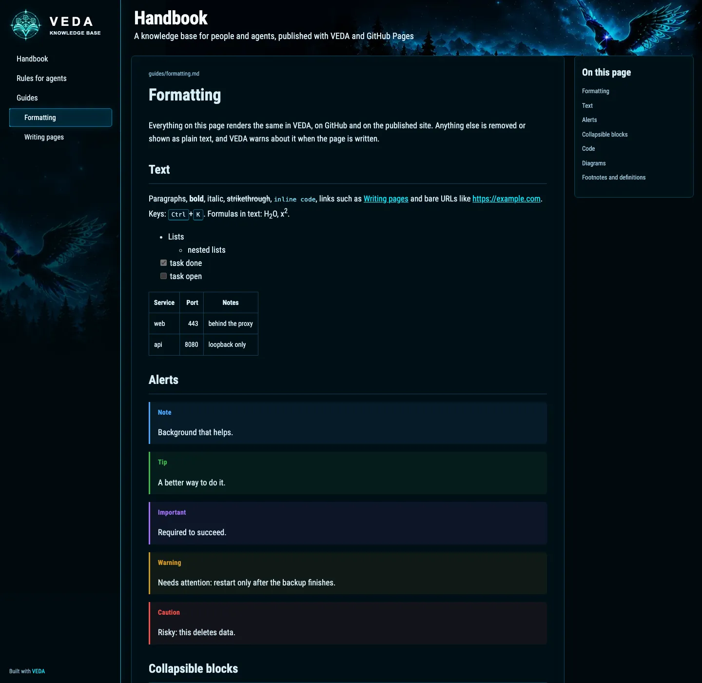
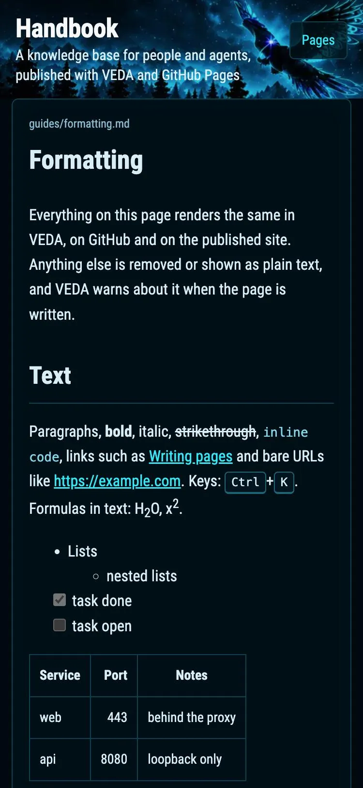

# Static site export

`veda-site` (also `veda export-site`) renders a wiki or program checkout as a
static website with the same Markdown rules as the reading interface:
collapsible blocks, GitHub alerts, footnotes, definition lists, highlighted
code, Mermaid diagrams and hidden front matter. It is meant for GitHub Pages
and any other static host.

The site looks like the reading interface: the same dark palette, Roboto
Condensed, the forest header, the article and "On this page" panels and the
same code colours. A sidebar lists the pages; on a phone it becomes a
"Pages" menu in the header, and the outline is hidden below 1100 px.





```bash
go install github.com/Mesteriis/veda-wiki/cmd/veda-site@main
veda-site --strict --lang en ./handbook ./_site
```

- The checkout is read like an import (`internal/importer`): only Git-tracked
  Markdown and images, a program source's `docs/` only, and never files
  withheld as credential-like or invalid. The summary line counts withheld
  files; their content is not published.
- `README.md` (else `index.md`) becomes the directory's `index.html`; other
  pages keep their names with `.html`. A program site's root redirects to
  `docs/index.html`.
- Links and images are rewritten to relative URLs, so the site also works under
  a project path such as `https://user.github.io/handbook/`. Links that leave
  the checkout are removed, as in VEDA.
- Every formatting warning VEDA would return on write is printed as
  `path:line: code: message`. `--strict` fails the run after writing when any
  page has one; use it in CI.
- `--lang en|ru` picks the alert titles and interface strings (default `en`);
  `--title` overrides the `veda.yaml` title.
- The output directory must be absent or empty; the export never overwrites
  files. It writes `.nojekyll`, `site.css`, `site.js` and `_veda/` with the
  fonts (SIL Open Font License, `_veda/fonts/LICENSE`), the header image and
  the logo, about 100 KB in all. `veda.yaml`'s `description` is the header's
  second line.
- Pages with diagrams load Mermaid 12.2.0 from jsDelivr in the reader's
  browser; without it the diagram source stays readable. The VEDA reading
  interface serves its own copy instead.

`veda-site` does not embed the reading interface, so `go install` builds it
without a frontend step.

## GitHub Pages

[`examples/wiki-template`](../examples/wiki-template/) is a starting wiki
repository: `veda.yaml`, `README.md`, `AGENTS.md`, a guide that shows every
supported construct and `.github/workflows/pages.yml`. To publish a wiki:

1. Copy `.github/workflows/pages.yml` into the repository and set
   `VEDA_VERSION` to a VEDA commit or tag.
2. In the repository settings, set Pages → Source to GitHub Actions.
3. Push to `main`; the workflow installs `veda-site`, exports the checkout with
   `--strict` and deploys the result.

A Pages site is public, even from a private repository, unless the plan
offers access-controlled Pages; publish only what anyone may read. VEDA's own visibility rules do not
apply to the published site.

The template is tested: `internal/site` exports it in strict mode and expects
no warnings, so the example cannot drift from the renderer.
