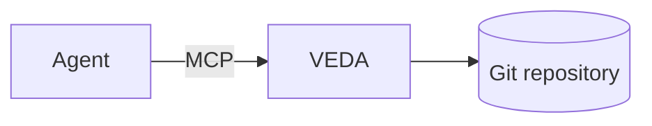
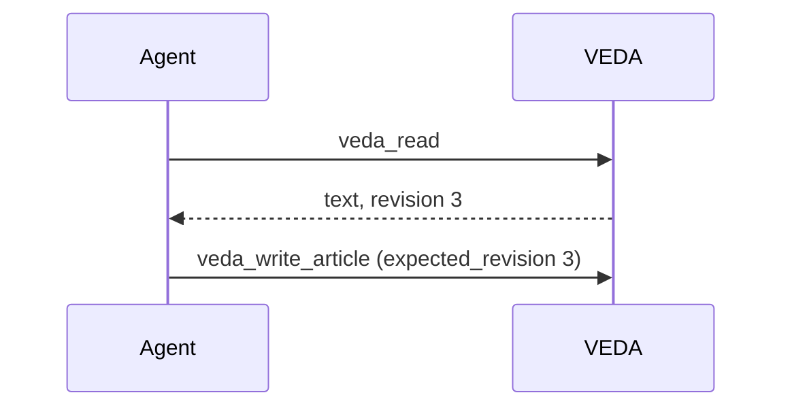

# VEDA formatting reference

Articles are Markdown that reads the same on GitHub, on a GitHub Pages site and
in VEDA. Use only what is listed here; anything else is removed or shown as
plain text. `veda_write_article` saves the text and returns `warnings` for what
the reader will not see as written: fix them and write again.

## Page

- UTF-8, at most 1 MiB, one `# Title` per page; the title is the first `# `
  heading unless front matter sets `title:`.
- Optional front matter for a GitHub Pages theme, hidden in VEDA:
  ```markdown
  ---
  title: Network
  nav_order: 2
  ---
  ```
- File names are lowercase and hyphenated; links and history depend on them.

## Text and structure

- Headings `##` to `####` build the table of contents; do not skip levels.
- Lists, task lists (`- [ ] todo`, `- [x] done`), tables, `~~strikethrough~~`,
  bare URLs become links.
- Inline: `<kbd>Ctrl</kbd>+<kbd>K</kbd>`, `H<sub>2</sub>O`, `x<sup>2</sup>`,
  line break `<br>`.
- Footnotes for sources and asides: `fact[^1]` and, anywhere below,
  `[^1]: where it comes from`.
- Definition lists for glossaries:
  ```markdown
  VLAN
  : A separate layer-2 network on shared switches.
  ```

## Alerts

For what a reader must not miss; at most a few per page.

```markdown
> [!NOTE]
> Background that helps.

> [!TIP]
> A better way to do it.

> [!IMPORTANT]
> Required to succeed.

> [!WARNING]
> Needs attention now: restart only after the backup finishes.

> [!CAUTION]
> Risky or destructive: this deletes data.
```

## Collapsible blocks

For long output, optional details and reference tables. Leave a blank line
after `<summary>` and before `</details>` so the Markdown inside renders. Add
`open` to show it expanded.

````markdown
<details>
<summary>Full nginx configuration</summary>

```nginx
server { listen 443 ssl; }
```

</details>
````

## Code

Always name the language of a fence: `bash`, `sh`, `yaml`, `json`, `toml`,
`ini`, `go`, `python`, `typescript`, `sql`, `nginx`, `dockerfile`, `diff`,
`text` for plain output. VEDA and GitHub highlight it.

## Diagrams

Mermaid fences are drawn by GitHub and VEDA; without JavaScript the reader sees
the source. Prefer `flowchart`/`graph` and `sequenceDiagram`, keep labels plain
text (no HTML), and check the syntax: an invalid diagram is shown as source.





## Links and images

- Relative (`../network/vlans.md`, `vlans.md#trunks`) or root-relative
  (`/network/vlans.md`) within the same source; a directory link opens its
  `README.md`. A link that leaves the source is removed.
- Images are files in the repository, at most 4 MiB:
  ``. Remote images are blocked.

## Not supported

- Raw HTML other than `<details>` (optionally `open`), `<summary>`, `<kbd>`,
  `<sub>`, `<sup>`, `<br>`; attributes, styles, scripts, iframes and comments
  are removed.
- Liquid or other template tags (``, `{{ }}`): shown as plain text.
- Math (`$…$`), emoji shortcodes and custom containers.

## Write warnings

| Code | Meaning |
| --- | --- |
| `raw_html` | A tag outside the allow list, or with attributes, is removed. |
| `liquid` | A template tag will show as text. |
| `link_outside_source` | The link leaves the source and is removed. |
| `image_outside_source` | The image path leaves the source and is not shown. |
| `image_remote` | A remote image is blocked by the page policy. |
| `code_without_language` | Name the fence language so it is highlighted. |

Each warning has the line in the article text, front matter included.
